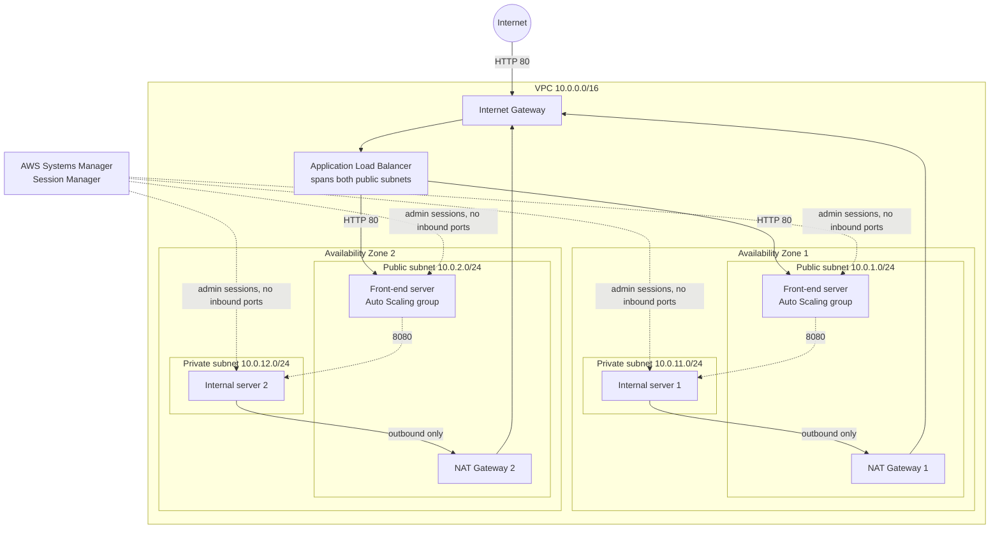

# Architecture

Everything below is created by `infrastructure/template.yaml`.

## Traffic rules in plain words

| Path | Allowed? | Why |
|---|---|---|
| Internet to load balancer, port 80 | Yes | Merchants and customers need to place and track orders. |
| Internet to front-end servers directly | No | Their security group only accepts the load balancer. |
| Internet to internal servers | No | No inbound rule, no public IP and no route from the Internet Gateway. |
| Internal servers to the internet (updates) | Yes, outbound only | Through the NAT Gateway in the same zone. Replies return, new inbound connections cannot start. |
| Engineers to any server | Via Session Manager only | Uses IAM and the AWS API. No port 22 and no key pairs. |

## What happens when something fails

| Failure | Result |
|---|---|
| One front-end server crashes | The load balancer health check marks it unhealthy within about 30 seconds and sends traffic to the other server. Auto Scaling replaces it. |
| A whole Availability Zone is lost | The load balancer keeps serving from the front end in the surviving zone. The internal server and NAT Gateway in that zone are also in the surviving zone, so updates and administration continue there. |
| One NAT Gateway fails | Only the internal server in that zone loses outbound internet. The front end is unaffected. |
| Traffic triples on a sales day | CPU target tracking adds front-end servers, up to the configured maximum. |

## Cost summary (approximate, us-east-1, verify in the AWS Pricing Calculator)

| Item | Approx. monthly cost |
|---|---|
| 2 NAT Gateways | about 65 USD plus data processing |
| 1 Application Load Balancer | about 16 to 20 USD plus usage |
| 4 small EC2 instances | Free Tier hours on a new account, otherwise a few USD each |
| VPC, subnets, routes, security groups, IAM, Session Manager | 0 |

Rejected alternatives: single NAT Gateway (a zone loss cuts updates and admin access for the other zone), SSM interface endpoints (similar cost, no package downloads), bastion host with SSH (open port and shared keys), and a private front end (no extra security and higher NAT cost).
